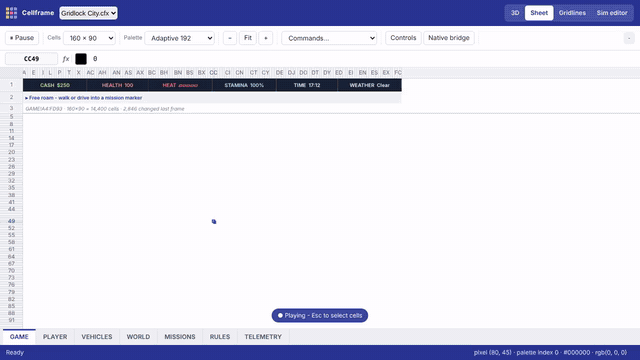
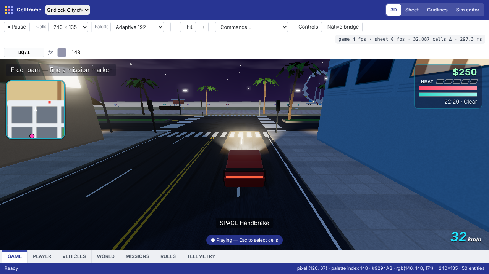
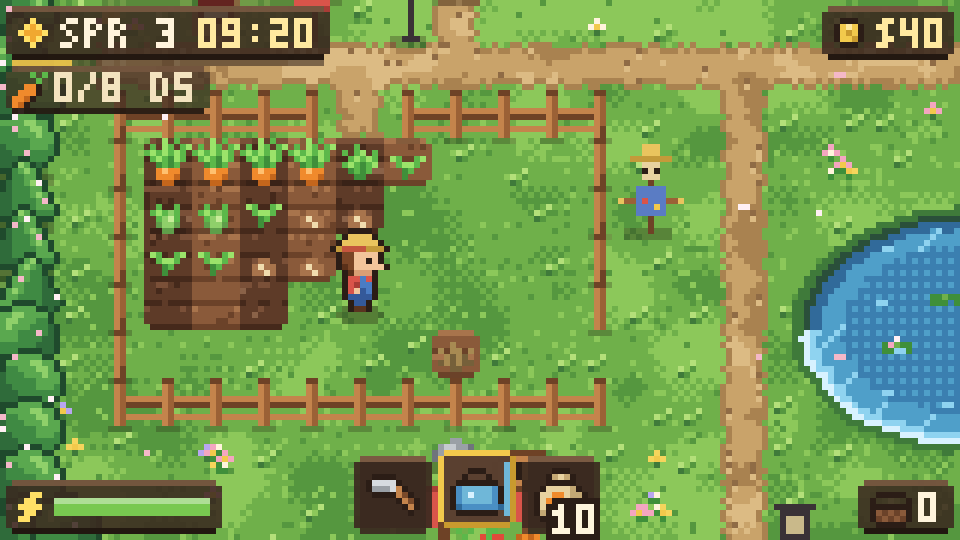
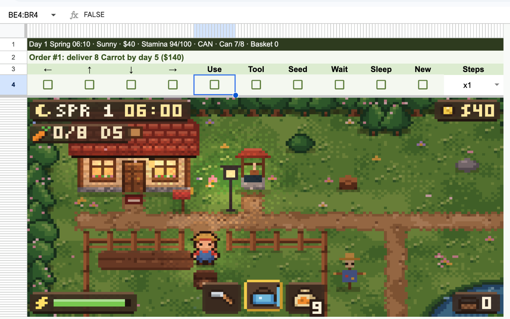

# Spreadsheet Game Studio

**Games where every pixel is a spreadsheet cell.** Two original games, one engine, and two
agent skills: one for building spreadsheet games, one for porting them to Google Sheets.



🎬 **[Watch the highlights video (mp4)](docs/media/highlights.mp4)**

| Gridlock City | Fieldbook | Fieldbook in real Google Sheets |
|---|---|---|
|  |  |  |
| Open world driving in an original coastal city, in the spirit of early 2000s classics | A farming and market sim whose prices are spreadsheet formulas | The whole game runs in the sheet's own script. Tap a box, play a move. Works on phones |

## What's in here

* **Two games.**
  * **Gridlock City**: third person 3D driving with traffic, pedestrians, police pursuits,
    weather, day and night, and three missions plus free roam (three.js).
  * **Fieldbook**: a 2D farm with seasons, crops, chickens, orders and a market
    (software raster, runs anywhere, including inside Google Sheets).
* **Four ways to play the same game.**

| Where | How | Status |
|---|---|---|
| Browser | A spreadsheet style app: the GAME sheet is the picture, other sheets are the game's variables and rules | Built, tested |
| LibreOffice Calc | A local bridge streams frames into real worksheet cells and syncs edits back | Measured |
| Microsoft Excel | Same bridge (COM or xlwings) | Written and unit tested; **not yet run on real Excel** |
| Google Sheets | Turn edition (phones too) and real time sidebar edition | Measured on a real sheet |

* **Live tuning.** Every tunable is a cell. Change a car's top speed, the weather or a
  crop's price formula while playing, and the game follows. Bad values are rejected and
  put back.
* **Two skills** for agents such as Claude (see [Skills](#skills)).

## Quick start

```bash
npm install
npm run build        # dist/index.html + dist/app.js (static site)
npm run serve        # http://127.0.0.1:8080
```

Open `http://127.0.0.1:8080/` for Gridlock City or `#fieldbook` for Fieldbook. Options:
`?res=320x180`, `?mode=3d|sheet|grid|editor`, `?bloom=0&shadows=0` (low preset), `?bridge=1`.

### Gridlock City controls

| Keys | Action |
|---|---|
| W A S D / arrows | Move, drive |
| Shift | Sprint |
| Space | Jump, handbrake |
| F / Enter | Enter, exit or take a vehicle |
| Mouse drag, Q / E | Rotate camera |
| C | Look back |
| R | Retry a failed job |
| Esc | Switch between playing and selecting cells |

Touch devices get a joystick and buttons over the GAME sheet.

### Things to try

1. Click any cell of the GAME sheet: the name box shows its address, the formula bar its value.
2. Switch to **Gridlines** and zoom in: every pixel is a cell.
3. **VEHICLES**: set *Sports car: max speed* to 300. **WORLD**: *Weather* = `Storm`.
   **RULES**: change `TrafficDensity` to `=Population*RushHourMultiplier*3`.
4. **Commands > Autodrive** lets the car cruise the city on its own.

## Google Sheets

```bash
node scripts/gsheets-port.mjs --game examples/fieldbook/turn.ts --mode turn --out dist/gsheets-phone
node scripts/gsheets-port.mjs --game examples/cell-catch/game.ts --mode both --out dist/gsheets-cell-catch
```

* **Turn edition** (`--mode turn`): the game runs inside the spreadsheet's Apps Script. The
  GAME tab has a row of checkboxes (← ↑ ↓ → Use Tool ...). Each tap fires a simple trigger
  that loads the saved game, plays one move, paints only the changed cells and saves. No
  permission prompt for players, and it works in the Sheets phone app.
* **Sidebar edition** (`--mode sidebar`): real time, in a desktop sidebar, any game.

Install: paste `Code.gs` into **Extensions > Apps Script**, save, then type into any cell.
Share a `/copy` link so each player gets their own copy. Details and lessons learned:
[`references/google-sheets.md`](references/google-sheets.md).

**Measured on a real sheet** (Fieldbook, 160x90 cells, Nov 2026): setup about 15 s, a tap
1.7 to 3.1 s end to end. The game's own work is under a second of that; the rest is Apps
Script starting up and saving, which a script can't remove. Phones in dark mode recolour
cells, so use *View in light theme* for true colours.

## Native Excel and LibreOffice

```bash
pip install -e renderers/excel/bridge
python scripts/excel/build_workbook.py tests/excel/fixtures/sample_hello.json --out GridlockCity.xlsx
python -m sgs_bridge --sink excel-com --workbook GridlockCity.xlsx   # Windows Excel
python -m sgs_bridge --sink calc-uno  --workbook GridlockCity.xlsx   # LibreOffice Calc
```

Then open the **local** build with `?bridge=1`. The game runs in the browser tab; the bridge
writes palette indices into the GAME sheet and conditional formats paint them. Edited values
and RULES formulas flow back. Measured on LibreOffice Calc 24.2: about 137 updates per second
for localised changes at 160x90, 66 for full frames ([`references/excel-backend.md`](references/excel-backend.md)).
Excel itself is untested here; `renderers/excel/native_test.py` measures it on Windows.

## Skills

Agent skills are folders of instructions an AI agent loads to do a job well.

* [`SKILL.md`](SKILL.md), **spreadsheet-game-studio**: build a new spreadsheet game. The
  workflow covers choosing the target, engine, variables and rules, cheap repaints, original
  assets, backends, tests, critics and measurement.
* [`skills/google-sheets-port/SKILL.md`](skills/google-sheets-port/SKILL.md),
  **google-sheets-port**: take a studio game (or its Excel workbook) to Google Sheets. Covers
  picking the edition, making a game portable, building, testing, installing in a real
  sheet, sharing and reporting honestly.

To use them with Claude, add each folder as a skill, or point Claude at this repo.

New game from the template:

```bash
node scripts/new-game.mjs my-game "My Game"
```

## Tests

```bash
npm test               # core, Fieldbook, Excel bridge (TS side), template
npm run test:gameplay  # Gridlock City scripted gameplay (headless)
npm run test:bridge    # bridge: Python tests + Calc via UNO
npm run test:gsheets   # Google Sheets editions against an in-memory Apps Script
npm run eval:browser   # authenticity, edits, performance, screenshots (needs a server on :8091)
```

The in-memory Apps Script (`tests/gsheets/fake-gas.ts`) implements only the methods the
editions call and throws on anything else, and runs each trigger in a fresh VM the way Apps
Script does.

## Videos

```bash
node scripts/serve.mjs dist 8091 &
node scripts/record-highlights.mjs    # dist/highlights.mp4 + docs/media/highlights.gif
```

Scenes are driven on a fixed simulated clock, so the video is smooth even on a slow machine.

## Layout

```
SKILL.md                    the studio skill
skills/google-sheets-port/  the Google Sheets port skill
engines/                    core contracts, host, formula engine; raster2d 2D engine
renderers/                  framebuffer pipeline, browser sheet, Excel/Calc bridge, Google Sheets
examples/                   gridlock-city (3D), fieldbook (2D), cell-catch (template), app (browser entry)
scripts/ templates/ references/ evals/ tests/ assets/ docs/
```

## Originality

All art is generated by code in this repository and listed in
[`assets/MANIFEST.json`](assets/MANIFEST.json). Gridlock City is inspired by a genre, not a
product: it uses no commercial game's assets, names, map, logo, HUD or missions, and it is
not affiliated with any game publisher.

## Licence

MIT, see [LICENSE](LICENSE).
