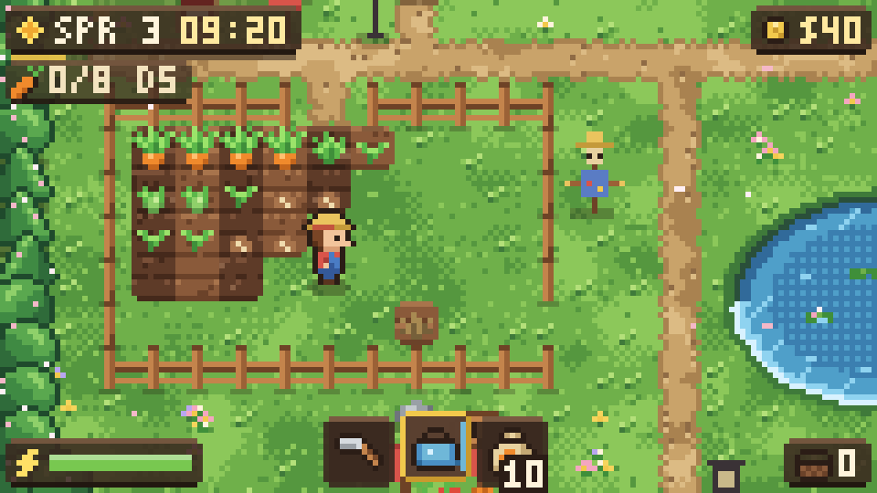
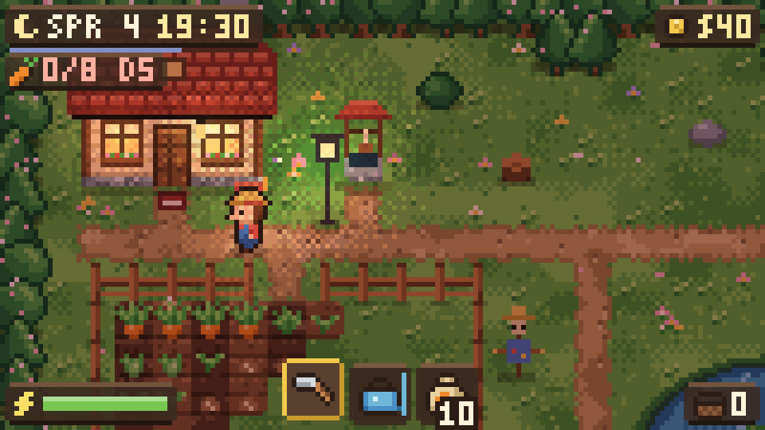
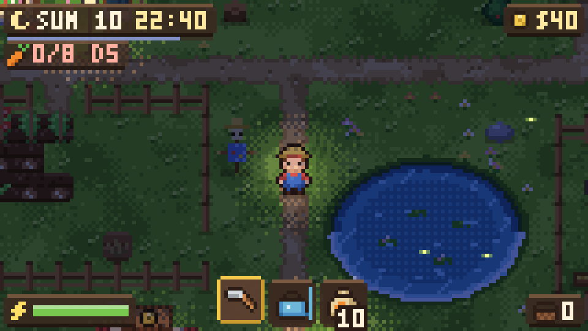
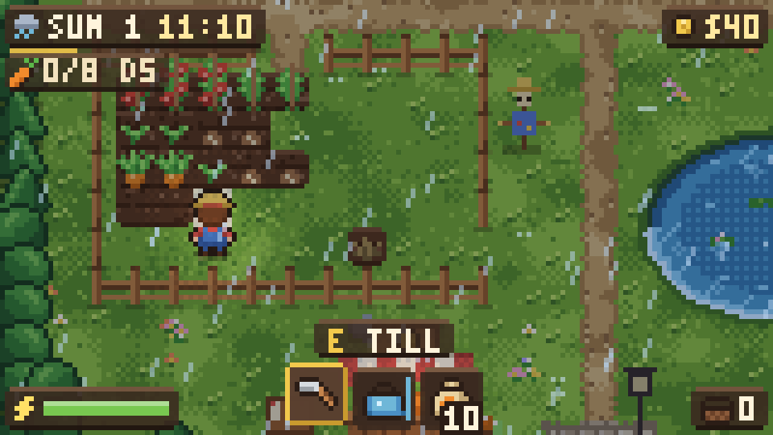
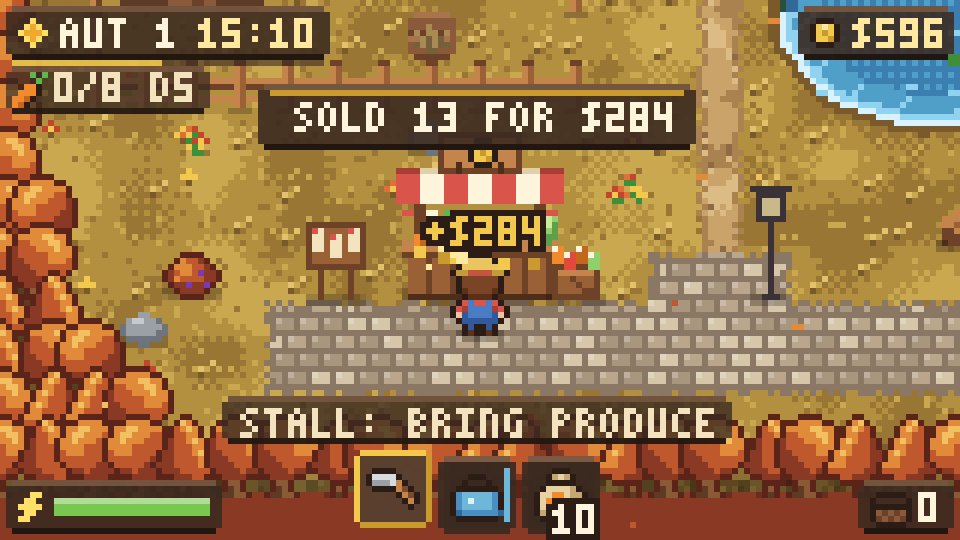
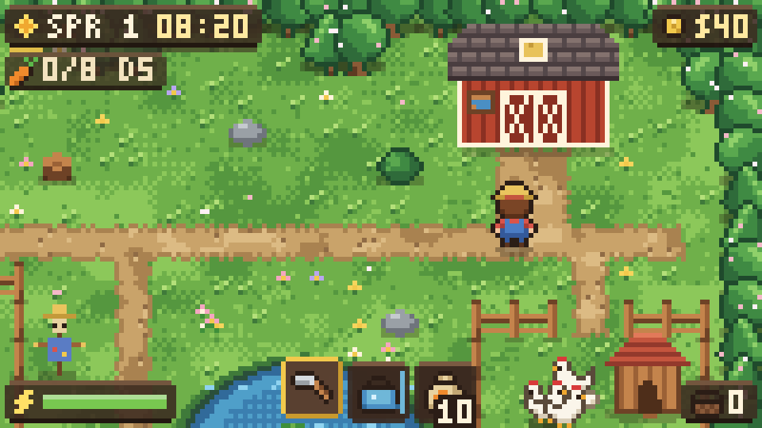
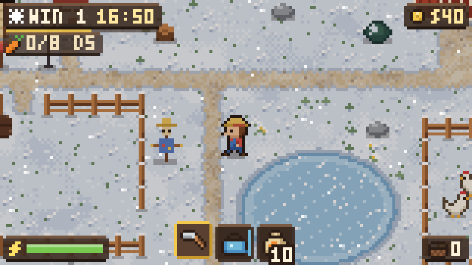

# Fieldbook

An original top-down farming and market sim built on the Spreadsheet Game Studio
contracts. It is the generalisation test: a second game that has almost nothing in
common with Gridlock City (3D driving). Fieldbook is 2D, built around turns of days,
and its loop is economic rather than action. It runs on the same `SpreadsheetGame`
contract, `VariableRegistry`, formula engine, `StudioHost`, `FramePipeline` and
backends, with no changes to any of them.



| | |
|---|---|
|  |  |
|  |  |
|  |  |

## The loop

1. **Till** grass inside the fenced field with the hoe, **plant** seeds (1-4 picks the crop),
   **water** with the can, and refill it at the well or the pond.
2. **Sleep** on the cottage doorstep (R). Each night, a plot that was watered gains
   `GrowthSpeed` growth-days. A plot left dry for `DroughtDays` nights withers. You
   pass out at 02:00, which costs stamina and a 10% doctor's fee.
3. Each morning the game rolls the weather: with probability `RainChance` it rains, and
   rain waters every plot. The season advances every `SeasonLength` days, and crops that
   are out of season wither. Hens lay eggs in the pen, and you pick them up by walking
   over them.
4. **Sell** at the market stall (E). Every unit is priced by the `Price_*` RULES at the
   moment of sale. Each unit sold raises `Sold_*`, which lowers `Demand_*`, so selling ten
   carrots in a row earns less per carrot than spreading sales across crops and days.
   Demand recovers overnight by `DemandRecovery`. Produce you keep and sell out of season
   earns `OffSeasonPremium`.
5. **Orders** (the ORDERS sheet, plus the notice board next to the stall) ask for a
   quantity by a due day and pay a lump-sum reward. You choose between selling now at
   the market price and holding stock for an order. An order that misses its due day is
   marked LATE. When orders close, new ones are generated from crops that grow in the
   current season.
6. **Spend**: buy seed packs at the crate (`SeedCost_*`) and upgrade the watering can at
   the shed (`UpgradeCost_Can`, `UpgradeSize_Can`). The tool you use costs
   `ToolStamina` per action.

Crops differ in growth time and season:

| Crop | Days | Seasons | Base price | Notes |
|---|---|---|---|---|
| Carrot | 3 | Spring, Summer, Autumn | $14 | cheap, fast |
| Tomato | 5 | Summer | $20 | regrows every 2 days after the first harvest |
| Pumpkin | 7 | Autumn | $62 | slow, valuable |
| Cabbage | 4 | Winter, Spring | $24 | the only winter crop |

## Controls

| Keys | Action |
|---|---|
| WASD / Arrows | Walk |
| E / Space | Use the current tool on the tile in front. Also sells at the stall, buys at the crate, upgrades at the shed, refills at the well or pond, and delivers at the board |
| Q | Cycle tool (hoe → can → seeds) |
| 1-4 | Select carrot / tomato / pumpkin / cabbage seeds |
| R | Sleep (on the doorstep) |

Touch buttons: ▲ ◀ ▼ ▶, Use, Tool, Seed (cycles crop), Sleep. Commands: `new-game`
and `skip-day`. `new-game` resets only the simulation-owned (`live`) values and keeps
your tuning edits.

## Sheets

Every variable changes gameplay, and the tests check this for each group.

**FARMER**: `Cash`, `Stamina`, `MaxStamina`, `ToolStamina`, `WalkSpeed` (tiles/s),
`CanCapacity`, `CanWater`, `CanLevel`, `Seeds_*` and `Basket_*` (Carrot, Tomato,
Pumpkin, Cabbage, Egg). The inventory lives in the registry, so typing
`Basket_Pumpkin = 10` into the sheet puts 10 pumpkins in the basket.

**FARM**: `Day`, `Hour` (6-26), `Season` (enum; editing it withers out-of-season
crops and recolours the world), `SeasonNo` (read-only numeric mirror for formulas),
`SeasonLength`, `DayLength` (seconds), `GrowthSpeed`, `RainChance`, `Weather` (set it
to Rain to water everything now), `DroughtDays`, `Chickens` (flock size), `EggChance`.

**MARKET**: `BasePrice_*`, `SeedCost_*`, `BasePrice_Egg`, `DemandDrop`,
`DemandRecovery`, `OffSeasonPremium`, `Sold_*` (recent sales pressure).

**RULES** (Excel-subset formulas, editable live):

```
Demand_Tomato      = MAX(0.3, 1 - Sold_Tomato * DemandDrop)
SeasonBonus_Tomato = IF(SeasonNo=2, 1, OffSeasonPremium)
Price_Tomato       = ROUND(BasePrice_Tomato * Demand_Tomato * SeasonBonus_Tomato, 0)
   (the same three rules exist for Carrot, Pumpkin and Cabbage)
Demand_Egg         = MAX(0.3, 1 - Sold_Egg * DemandDrop)
Price_Egg          = ROUND(BasePrice_Egg * Demand_Egg * IF(SeasonNo=4, 1.25, 1), 0)
UpgradeCost_Can    = 60 * CanLevel ^ 2
UpgradeSize_Can    = 4 + 2 * CanLevel
SleepRestore       = MaxStamina * IF(Hour < 24, 1, 0.75)
```

**ORDERS** (custom sheet): `Order, Item, Qty, Delivered, Due day, Reward, Status`.
Row styles are `done`, `failed` (LATE) and `active` (due tomorrow).
**FIELD** (custom sheet): one row per tilled plot, showing crop, stage, growth, watered
and dry days.

## Resolution and rendering

The game always draws a 160x90 logical frame (8 px tiles; the farm is 32x22 tiles and
the camera follows the farmer). `raster2d.present()` maps that frame onto any cell
grid:

| Target | Result |
|---|---|
| 320x180, 480x270, 640x360 | exact integer nearest-neighbour (2x, 3x, 4x) |
| 160x90 | 1:1 |
| 240x135 | 1.5x fractional nearest-neighbour; integer 1x would leave a third of the grid empty |
| 80x45 | 2x2 area average. Below 1x the HUD switches to a compact, text-free variant |
| any other aspect | letterboxed (`fit: "contain"`) or cropped (`fit: "cover"`) |

`renderDirect` draws the same frame on its own canvas through `CanvasPresenter`, at
the largest integer scale that fits the mount. It uses putImageData plus
`imageSmoothingEnabled = false`. In Node, `canvas()` throws a clear error, while
`step()` and `renderCells()` work headless. `cells-160x90-fixed64.png` shows the frame
after the shared pipeline's fixed 64-colour palette, which is what the Excel bridge
uses by default.

## What the second game proves about the skill

**Reused unchanged**: the `SpreadsheetGame` contract (`engines/core/game.ts`),
`VariableRegistry` with validation and RULES, the formula engine (`formula.ts`),
`InputState` and key bindings, `StudioHost` (fixed step, patches, telemetry,
resolution changes), `FramePipeline` (quantise and diff), and every backend. Backends
only ever see `IndexedFrame`s, so they cannot tell this game apart from the 3D one.
`tests/fieldbook/render.test.ts` drives Fieldbook through the real `StudioHost` and
`FramePipeline` with a fake cell backend, applies sheet patches (including a rejected
formula and a rejected value), and switches resolution.

**New**: `engines/raster2d/`, a reusable, DOM-free software 2D raster engine. Nothing in
it is specific to Fieldbook:

- `Surface`: an RGBA Uint8Array with origin (camera) and clip. It provides clear, pset,
  fillRect and rect with alpha, line, circle, ellipse, sprite blit (flipX/flipY,
  alpha, tint, silhouette) and surface copy.
- `spriteFromStrings` / `defineSprites`: palette-string pixel art, plus `recolor`,
  `flipSpriteX`, `stackSprites` and `animFrame`.
- A 3x5 pixel font (`drawText` with shadow, outline and alignment; `textWidth`).
- `TileMap` with visible-range iteration and neighbour masks for autotiling.
- `applyLighting`: ambient multiply plus banded, ordered-dithered point lights. Also
  `dayNightAmbient` keyframes and `tintOverlay`.
- `ParticleSystem`: emission takes the caller's RNG, so seeded simulations stay
  deterministic.
- `hash2`, `valueNoise`, `fbm`, `bayer4`: procedural textures that never consume game
  randomness.
- `present` / `computeFit` / `upscale`: resolution independence. `CanvasPresenter` is
  guarded by `hasDom()`.

**Game-specific** (examples/fieldbook): `defs.ts` (crops, variables, rules, bindings),
`map.ts` (layout), `sim.ts` (simulation, no drawing), `art.ts` (palette, sprites,
procedural props), `render.ts` (scene and UI), `game.ts` (contract wiring),
`snapshot.ts` and `png.ts` (screenshots).

All art is original: hand-authored palette strings and procedural drawing, with no
external assets.

## Running

```
node --import tsx --test tests/fieldbook/*.test.ts      # 20 tests
node --import tsx examples/fieldbook/snapshot.ts         # writes screenshots/*.png
```

## Contract notes found while building this

These are notes only; nothing in `engines/core` was changed.

- `VariableRegistry.setLive()` neither recomputes rules nor notifies listeners. A game
  that drives rule inputs from the simulation (`Sold_*`, `CanLevel`, `Hour`) has to call
  `recomputeRules()` itself, or the RULES sheet goes stale.
- Formula name lookup goes through `num()`, so `enum` and `text` variables evaluate to
  0. The parser supports `"Winter"` string literals and `=`, but
  `IF(Season="Winter", …)` can never be true. Fieldbook works around this with a
  read-only numeric `SeasonNo`.
- `StudioHost.stop()` / `shutdown()` call `cancelAnimationFrame` without checking that
  it exists, so they throw in Node even though `frame()` is documented as usable
  headless. The host test shims it.
- `renderDirect(alpha, width, height)` receives `0, 0` from the host, so a game cannot
  tell its target size and has to measure its own mount. `canvas()` must return an
  `HTMLCanvasElement`, so headless games can only throw. Something like
  `canvas(): HTMLCanvasElement | null` would be friendlier.
