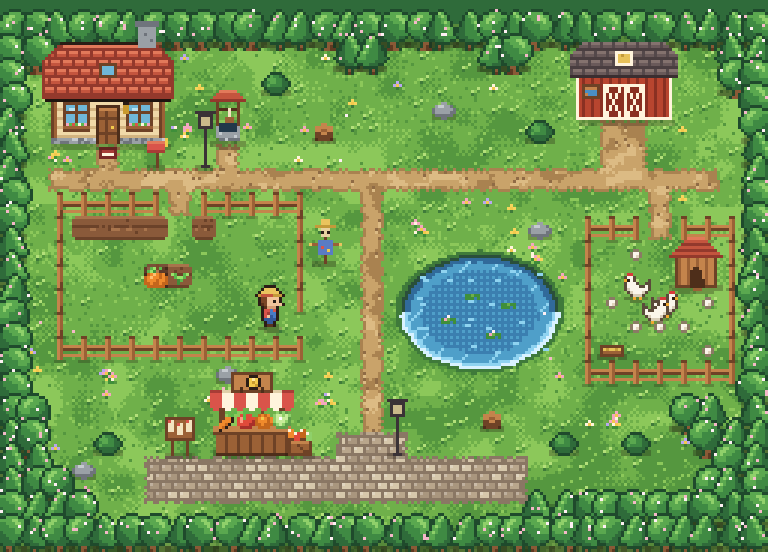
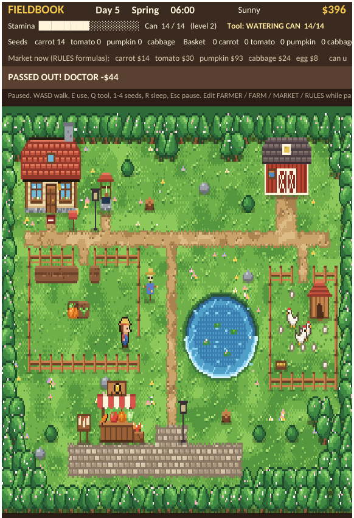

# Fieldbook for Excel

The farm game runs inside a real Excel workbook, in real time. Every cell of the
FIELDBOOK sheet is one pixel (256 x 184 cells), the game's variables live in normal
sheets, and the market prices are real Excel formulas.

*A frame composed and painted into the cells by the VBA game. This capture comes from the
automated test run in LibreOffice.*

## Get it

Download both files from [`downloads/`](../../../downloads):

* `Fieldbook.xlsx`: the workbook. It opens showing the farm, with all the variables and
  formulas in place.
* `Fieldbook.bas`: the game itself, one VBA module.

## One-time setup (about 30 seconds)

1. Open `Fieldbook.xlsx`. If Excel shows Protected View, click **Enable Editing**.
2. Press **Alt+F11** to open the VBA editor (Mac: Tools > Macro > Visual Basic Editor).
3. In the editor, choose **File > Import File...**, pick `Fieldbook.bas`, then close the editor.
4. Choose **File > Save As > Excel Macro-Enabled Workbook (\*.xlsm)**.
5. On the FIELDBOOK sheet, press **Alt+F8**, choose **FB_Play** and click Run.

After the first run, the sheet has a Play / Pause button and F12 toggles play. The game
saves itself into the workbook each time you pause or sleep, so a saved `.xlsm` picks up
where you left off.

## Controls

| Keys | Action |
|---|---|
| W A S D / arrows | Walk |
| E / Space | Use the tool on the tile in front. Also sells at the stall, buys seeds at the crate, upgrades the can at the shed, refills at the well or pond, and delivers at the order board |
| Q | Cycle the tool: hoe, watering can, seeds |
| 1-4 | Pick carrot, tomato, pumpkin or cabbage seeds |
| R | Sleep (on the cottage doorstep) |
| Esc / F12 | Pause. While paused you can edit any sheet |

## Change the game from the sheets

| Sheet | What is there |
|---|---|
| FARMER | cash, stamina, walk speed, watering can, seeds and basket (type `Basket_Pumpkin = 10` and you have ten pumpkins) |
| FARM | day, time, season, day length, growth speed, rain chance, weather, flock size, egg chance |
| MARKET | base prices, seed costs, demand drop and recovery, off-season premium, recent sales |
| RULES | the formulas: `Price_Carrot = ROUND(BasePrice_Carrot * Demand_Carrot * SeasonBonus_Carrot, 0)`, `UpgradeCost_Can = 60 * CanLevel ^ 2`, ... |
| ORDERS | live orders: quantity, due day, reward, status |

Pause, edit a cell, press Play. Things to try: set `Season` to Winter, `Weather` to Rain,
change the `Price_Pumpkin` formula to `=500`, or set `WalkSpeed` to 12.

## How it works

* **The art is shared with the browser edition.** `scripts/excel/export-fieldbook-assets.ts`
  runs the same renderer to produce every season's background, each building, tree and fence
  as its own sprite, the farmer, hens, eggs and crops, and the soil textures. The builder
  stores them in a hidden `_ASSETS` sheet.
* **The rules mirror `examples/fieldbook/sim.ts`**, ported to VBA: tilling, watering, growth
  overnight, withering, seasons, rain, eggs, the market with demand, orders, the can upgrade,
  stamina and passing out at 02:00.
* **Drawing.** Each frame, the game composes the picture in memory: the season background,
  then tilled soil, then crops, eggs, hens and the farmer sorted by depth. Buildings and
  fences are redrawn in front of anything standing behind them. The game then repaints only
  the cells whose colour changed, sending runs of one colour as a single range. A typical
  walking frame touches a few dozen ranges.
* **Light.** Night is a translucent shape over the canvas, and lamp glows are soft-edged
  shapes. Rain and snow are drawn as pixels.
* **Cells are the truth.** The game reads its variables from the sheets every frame and
  writes back what changes (cash, stamina, seeds, the clock). A value you edit in a sheet
  wins over the game's own copy.

Rebuild everything with `npm run build:excel`.

## Tests

`npm run test:excel-fieldbook` opens the real workbook in headless LibreOffice, loads the
module in LibreOffice's VBA compatibility mode, and plays a scripted game. It walks the
farmer and checks collisions, then tills, waters and plants. It sleeps three nights to grow
a carrot, harvests it and sells it at the stall at the `Price_Carrot` formula. It buys
seeds, refills the can, fills an order, upgrades the can, edits sheet cells (Weather,
WalkSpeed, Hour) and passes out at 02:00. Finally it checks that 300 sampled canvas cells
hold exactly the colours the game composed.

*The whole sheet after the test run, as LibreOffice prints it. LibreOffice draws the narrow
columns narrower than Excel does; in Excel the game squares the cells on start.*

## Honest notes

* **It has not been run in Microsoft Excel yet.** The game logic, the compositor and the cell
  painting are tested in LibreOffice's VBA mode. These Excel-only parts are not tested:
  * the keyboard (Windows `GetAsyncKeyState`, Mac `Application.OnKey`)
  * the frame loop timing
  * the night and glow shapes
  * the Play button
  * squaring the cells and fitting the window
* **Windows is the main target.** On a Mac, keys go through `Application.OnKey`, which has no
  key-up event, so walking is less smooth. Treat the Mac path as experimental.
* **Frame rate depends on Excel and the machine.** Expect walking at tens of frames per
  second. Rain repaints more cells, so it costs more.
* **You import the macro once.** This build process cannot write the binary VBA project a
  ready-made `.xlsm` needs, so you import the module yourself the first time.
