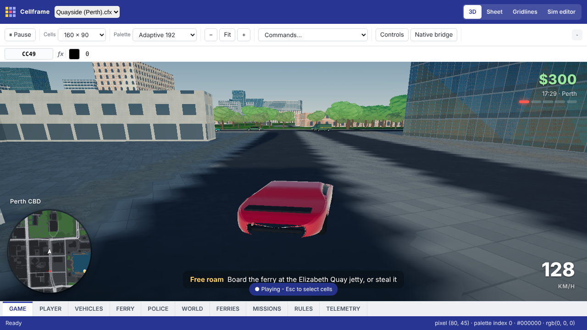
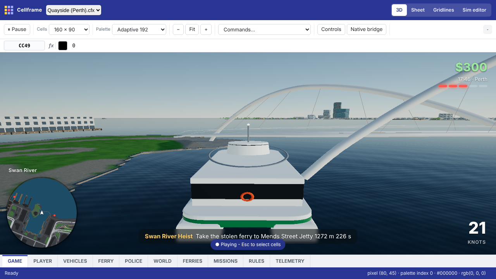
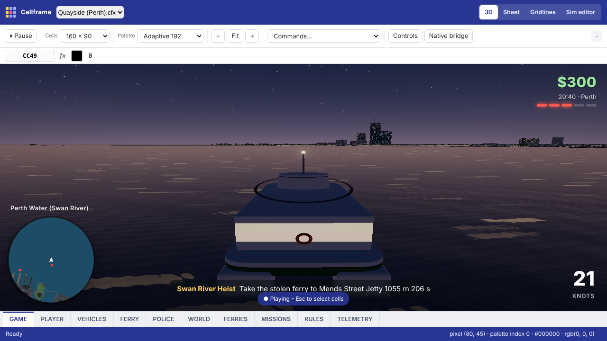

# Quayside (Perth)

A third person open world game set on the real **Elizabeth Quay** in Perth, Western Australia.
Walk the quay, take a car along The Esplanade and Riverside Drive, ride the ferry across Perth
Water to Mends Street Jetty in South Perth, or storm the wheelhouse and steal it while the
river police give chase.

| Golden hour on The Esplanade | The stolen ferry on Perth Water | Night on the river |
|---|---|---|
|  |  |  |

## The place is real

The map is built from **OpenStreetMap** data for the Elizabeth Quay area, not drawn by hand:

* **1,179 buildings** extruded from their real footprints, at their mapped heights (or from
  the number of levels). Towers get glass curtain walls, heritage buildings brick or
  sandstone, low buildings shopfronts.
* **The street network** (The Esplanade, Barrack Street, William Street, Riverside Drive, Mounts
  Bay Road and the rest) drives the traffic, which keeps to the left as in Australia.
* **The river and the inlet**: the shoreline, the quay walls, the island and the
  Elizabeth Quay footbridge, which you can walk over and the ferry passes under.
* **Landmarks** placed at their mapped positions: the Elizabeth Quay Bridge with its two
  crossing arches, the Spanda sculpture, the Bell Tower, the Elizabeth Quay and Barrack Street
  jetties, and Mends Street Jetty in South Perth.
* **The ferry** follows the mapped South Perth ferry route. At the default 20 knots the
  crossing takes about three minutes of game time.

The landmark models were checked against public photographs of the quay. They are original
models built in code, and the ferry uses a generic white and green livery with no operator
branding.

## Play

```bash
npm install && npm run build && npm run serve
```

Open `http://127.0.0.1:8080/#quayside` (or pick **Quayside (Perth).cfx** in the file menu).

| Keys | Action |
|---|---|
| W A S D / arrows | Walk, drive, steer the ferry |
| Shift | Run |
| F / Enter | Get in or out of a car, board or leave the ferry |
| G | Steal the ferry (from the jetty, or take the helm while riding) |
| Space | Handbrake |
| Mouse drag, Q / E | Turn the camera |
| R | Restart |

**Missions.** *The Ten-Minute Crossing*: pay the fare and ride to the other side (+$50).
*Swan River Heist*: steal a ferry and dock it at Mends Street Jetty before the timer runs out.
Stealing a ferry earns three stars, and police boats launch to intercept you; on land, police
cars join in. Lose them for long enough and the heat cools down.

**Commands** (toolbar): morning, golden hour or night; jump to either jetty; cinematic camera.

## Edit the game from the sheets

Like every Spreadsheet Game Studio game, the tunables are cells:

| Sheet | Examples |
|---|---|
| PLAYER | cash, health, heat, invincible |
| VEHICLES | top speed, grip and acceleration of each car |
| FERRY | ferry speed, dwell time at the jetty, fare, top speed when you steal one |
| POLICE | response, police boat speed, cool-down time |
| WORLD | time of day, time scale, traffic and crowd density, heist reward |
| RULES | `TrafficCars = ROUND(26*TrafficDensity, 0)`, `HeistReward`, police counts |
| FERRIES, MISSIONS | live read-outs of each ferry and the current mission |

## How it is built

```
data/osm-eq.txt              compact OSM export (Overpass), the only external input
scripts/quayside/build_city.py   -> data/city.json (buildings, roads, piers, trees, landmarks)
                                 -> data/ground.png (1 m per pixel ground classes: water, road,
                                    plaza, grass, pier, footbridge, ...)
src/map.ts                   loads both; the raster answers "what is under this point?"
src/sim/world.ts             the game: on foot, cars, ferries, police, traffic, missions
src/sim/collide.ts           raster collision, so the Gridlock City car and walking physics
                             run unchanged on the real map
src/render/                  three.js: procedural facades, river shader, sky and sun path,
                             landmarks, post processing (bloom, grade, ACES)
```

Rebuild the map from the export with `python3 scripts/quayside/build_city.py`.

Tests: `npm run test:quayside` (map, colliders, the ferry timetable, riding as a passenger,
the heist, traffic flow and editable rules, all headless).

## Honest notes

* It is a stylised, real time scene, not photogrammetry. Buildings are footprints with
  procedural facades, so individual towers look like their shape and height, not their exact
  cladding.
* Building heights come from OSM where mapped and are estimated from levels elsewhere.
* The ferry timetable is simplified (one service each way at a time, fixed dwell).

## Map data

© OpenStreetMap contributors, [ODbL 1.0](https://opendatacommons.org/licenses/odbl/1-0/).
The derived files in `data/` are available under the same licence; see
[`data/LICENSE-DATA.md`](data/LICENSE-DATA.md). Everything else is MIT.
